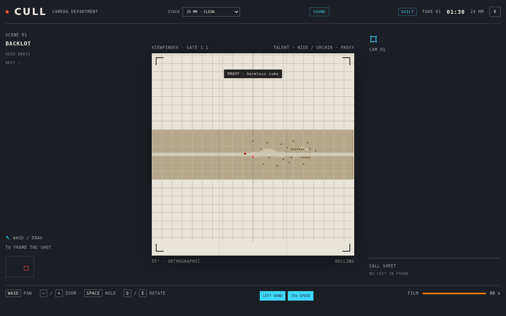
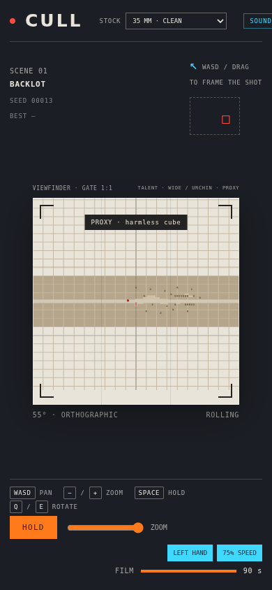
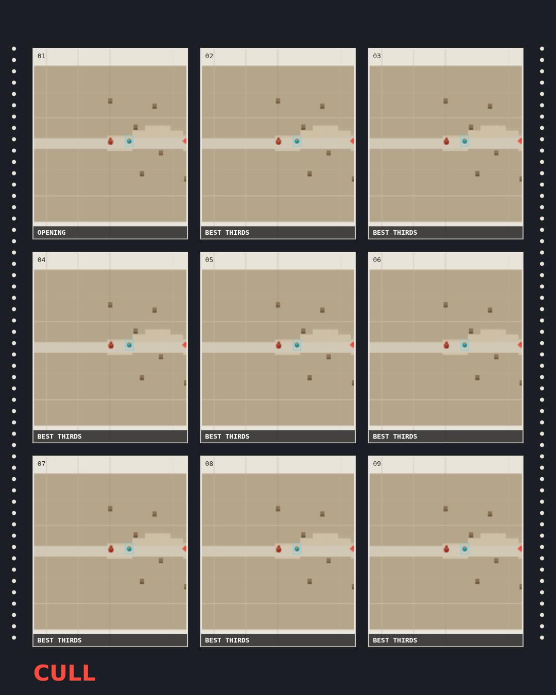

# CULL

**CULL is a deterministic browser game about camera work.** Pan and zoom an orthographic viewfinder to keep the Talent in frame, cut hazards at the frame edge, and collect Reels. The camera is the main control surface: framing affects what survives, what becomes visible, and how long the Shoot lasts.

> Current playable build: [open CULL on GitHub Pages](https://aieatassam.github.io/cull-game/). Use WASD or drag to pan, `+`/`−` or the zoom slider to zoom, `Q`/`E` to rotate, and Space/HOLD to keep the Talent in place. `?daily=1` starts the UTC daily seed; `?shoot=1` enables the multi-scene Shoot.

## Screenshots

Desktop view, with the viewfinder and call sheet:



Mobile layout and touch controls:



Contact sheet and share summary:



Sound settings and film-stock looks are available in the current build. The screenshot set for earlier milestones is in [`artifacts/screens/`](artifacts/screens/).

## What is implemented

- Deterministic fixed-tick simulation, seeded scene generation, camera pan/zoom/rotation, Talent pathing, hazards, film, and cut lifecycle.
- Multiple entity behaviors, level-of-detail tiers, adaptive pixel ratio, accessibility controls, reduced-motion support, and optional audio settings.
- A miniature film-set art pass gives the Talent a layered red-coat costume, adds varied silhouettes and colors to Extras, and gives hazards and props distinct material details while preserving their existing LOD rules.
- UTC daily seed, local filmography and personal best, transparent run grades, replay URLs, contact-sheet PNGs, native file sharing when supported, and optional WebM director reels.
- Grade-unlocked cosmetic film stocks: Kodachrome (B), bleach bypass (A), and Ilford black and white (S). Lens feats unlock Anamorphic, Tilt-shift, Fisheye, Long Lens, and Super 8. Replay URLs preserve lens identity; deterministic replay-based contact-sheet rendering is still in progress.

The M5/M6 automated bot acceptance thresholds remain unmet, and physical weak-GPU/phone sign-off remains open. See [progress and measured gates](docs/PROGRESS.md) for the current results and limitations.

## Run locally

Requires Node.js and npm.

```sh
npm ci
npm run dev
```

Useful checks:

```sh
npm run typecheck
npm run lint
npm test
npm run build
npm run size
```

## Milestone tags and releases

Each `mN` tag marks a project milestone. GitHub Releases use the same names and include milestone notes. Some earlier milestone tags intentionally share a commit where work was recorded together; the release notes state what that snapshot contains and call out unmet acceptance gates.

| Tag | Milestone |
| --- | --- |
| [`m0`](https://github.com/AieatAssam/cull-game/releases/tag/m0) | Scaffold and build tooling |
| [`m1`](https://github.com/AieatAssam/cull-game/releases/tag/m1) | Deterministic simulation core |
| [`m2`](https://github.com/AieatAssam/cull-game/releases/tag/m2) | Greybox game and camera controls |
| [`m3`](https://github.com/AieatAssam/cull-game/releases/tag/m3) | Hysteretic multi-tier LOD |
| [`m4`](https://github.com/AieatAssam/cull-game/releases/tag/m4) | Cast roster, hazards, Reels |
| [`m5`](https://github.com/AieatAssam/cull-game/releases/tag/m5) | Generator and bot validation snapshot; acceptance gate remains red |
| [`m6`](https://github.com/AieatAssam/cull-game/releases/tag/m6) | Shoot structure and second roster snapshot; acceptance gate remains red |
| [`m7`](https://github.com/AieatAssam/cull-game/releases/tag/m7) | Visual signature and adaptive rendering snapshot |
| [`m8`](https://github.com/AieatAssam/cull-game/releases/tag/m8) | Audio mix settings |
| [`m9`](https://github.com/AieatAssam/cull-game/releases/tag/m9) | Meta progression and sharing |
| [`m10`](https://github.com/AieatAssam/cull-game/releases/tag/m10) | Accessibility polish and human review gate |

## Project notes

- [Design brief](docs/CULL.md)
- [Architecture](docs/ARCHITECTURE.md)
- [Milestone progress and acceptance results](docs/PROGRESS.md)
- [Decisions](docs/DECISIONS.md)
- [Morning report](docs/MORNING-REPORT.md)
