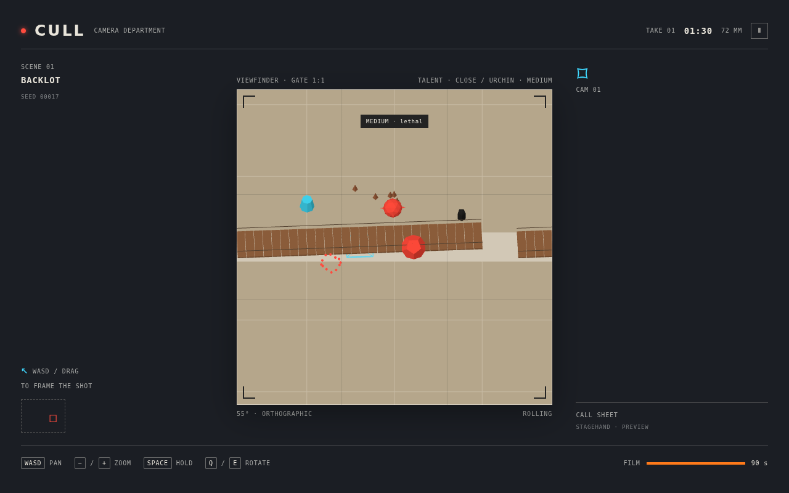

# ⚠️ ABANDONED — FAILED EXPERIMENT

**CULL was abandoned on 2026-10-15 and is no longer being developed.** The core loop, escorting a felt puppet through a film set with a camera, never became fun. Moving and steering felt awkward, even after the Shutter reshape and several UX passes. The repo and the [live build](https://aieatassam.github.io/cull-game/) stay up as a record of the attempt.

**Worth salvaging:** the felt-puppet art, the deterministic replay and bot balance harness, and the camera-upgrade ideas (Flash, Thermal, X-ray, Render Pass).

**Post-mortems and reviews:** [concept review](docs/design/concept-review-2026-10-13.md) · [gameplay loop review](docs/design/loop-review-2026-10-13.md) · [UX audit](docs/design/ux-audit-2026-10-14.md) · [art and gameplay review](docs/design/review-2026-10-12.md)

---

# CULL

CULL is a deterministic browser game about camera work. Pan and zoom the viewfinder to keep the Talent in frame, and press CUT to slice off every hazard outside the frame. Whatever is outside the shot does not exist.

**Play:** [aieatassam.github.io/cull-game](https://aieatassam.github.io/cull-game/)



## Controls

- WASD or drag to pan; pinch to zoom on touch
- `+` / `−`, the mouse wheel or the zoom buttons to zoom
- Space, Enter or the CUT button to cut everything outside the frame
- `H` or HOLD to keep the Talent on her mark
- `Q` / `E` to rotate
- `P` or Escape to pause
- `?daily=1` starts the UTC daily seed

## Develop

Requires Node.js and npm.

```sh
npm ci
npm run dev
```

Checks: `npm run lint`, `npm run typecheck`, `npm test`, `npm run test:e2e`, `npm run build`, `npm run size`.

The campaign design is [`docs/design/game-design.md`](docs/design/game-design.md). Core rules, LOD and tech notes stay in [`docs/CULL.md`](docs/CULL.md). Architecture is [`docs/ARCHITECTURE.md`](docs/ARCHITECTURE.md). Decisions are [`docs/DECISIONS.md`](docs/DECISIONS.md).
